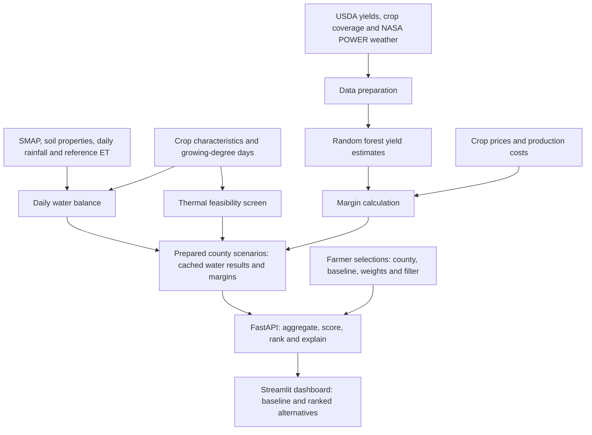

# FieldShift: Adapting Farms with NASA Data

FieldShift is our project for the NASA Farming Challenge. It combines agricultural data, NASA Earth observations, machine-learning yield estimates, and environmental analysis to help farmers compare crop rotation strategies.

## System Architecture

## Data Sources and Preparation

### 1. Collect USDA County Yield Data

We downloaded county-level farm yield data for a variety of crops covering **2019–2025** from [USDA Quick Stats](https://quickstats.nass.usda.gov/).

- **Dataset:** `files/usda_yields.csv`

### 2. Aggregate Cropland Coverage

We downloaded annual crop coverage data from the [USDA Cropland Data Layer](https://www.nass.usda.gov/research-and-science/cropland/release).

The data identifies crops grown across the United States at a 30-meter pixel resolution. To connect these observations with county-level yield data, we aggregated the pixels into 5 km squares, each represented by its center latitude and longitude. For each square, the script calculates crop percentages and pixel counts.

- **Script:** `scripts/Loadcdls.py`
- **Output:** `files/national_crop_rotations.py`

### 3. Reshape County Yield Data

We cleaned and pivoted the USDA yield data to create a separate column for each crop-year yield measurement at the county level.

- **Script:** `pivot_yields.py`
- **Output:** `county_yields_wide.csv`

### 4. Match Cropland Observations to Counties

We used GeoPandas to assign each cropland square’s latitude/longitude centroid to a county, then merged the cropland observations with county yield data.

Because we were unfamiliar with GeoPandas, we used ChatGPT to help develop this script.

- **Script:** `merge_cdls_to_yields.py`
- **Output:** `cdl_with_yields.py`

### 5. Aggregate Crop Percentages by County

We combined multiple cropland observations into one record per county. County crop percentages are calculated using the pixel counts of the associated 5 km squares as weights.

- **Script:** `cdl_with_yields_cleanup.py`

### 6. Merge NASA POWER Data

We merged the agricultural dataset with weather data obtained from [NASA POWER](https://power.larc.nasa.gov/).

- **Script:** `nasa_data_merge.py`
- **Output:** `nasa_data_merged.py`

## Yield Prediction Models

The script `training_data_files_generation.py` creates the training CSV files. We evaluated three machine-learning models separately on the corn, oats, and soybean datasets.

### MLP Neural Network Results

| Crop | MAE | MSE | R² |
|---|---:|---:|---:|
| Corn | 19.30 | 669.10 | 0.553 |
| Oats | 14.95 | 444.97 | -0.459 |
| Soybeans | 5.54 | 52.12 | 0.607 |

### Linear Regression Results

| Crop | MAE | MSE | R² |
|---|---:|---:|---:|
| Corn | 27.02 | 1178.28 | 0.212 |
| Oats | 12.89 | 298.16 | 0.022 |
| Soybeans | 8.07 | 110.90 | 0.165 |

### Random Forest Regression Results

| Crop | MAE | MSE | R² |
|---|---:|---:|---:|
| Corn | **15.76** | **447.60** | **0.701** |
| Oats | **10.92** | **211.87** | **0.305** |
| Soybeans | **4.74** | **37.95** | **0.714** |

### Selected Model

Random forest performed best among the three models. We then applied each crop’s trained `RandomForestRegressor` to its entire original training dataset to generate yield estimates for every county-year record in the corn, oats, and soybean datasets.

## Backend: Environmental Analysis and Rotation Ranking

The FastAPI backend supports **595 U.S. counties** for corn and soybean comparisons.

- **Water shortfall:** A daily soil-water balance combines planting-day SMAP, soil storage capacity, precipitation, and crop demand calculated from reference ET₀ and stage-specific crop coefficients. Growing-degree days screen thermal feasibility.
- **Economics:** ML-predicted yield × crop price − production cost. Default margins use 2025 national prices and 2026 regional cost proxies, held constant across both planning years.
- **Scenarios:** Evaluate up to four consecutive historical pairs from 2020–2024, averaging annual margins and two-year water shortfalls across complete pairs.
- **Ranking:** Normalize both indicators, apply farmer-selected weights and the crop-family filter, and return a scored baseline plus up to two ranked alternatives with explanations.

Environmental results and default margins are precomputed. **All 23 backend tests pass.**

## Frontend: 

### Modeling Assumptions

The model assumes fixed root depth and zero irrigation. Previous-crop yield effects and direct soil-health changes are not modeled.

## AI Usage

During this 48-hour hackathon, where AI/SI usage was encouraged, we used ChatGPT to help develop many of the data aggregation and loading scripts.

The model-training code was mostly handwritten, with limited AI assistance to speed up repetitive code changes across crop datasets.

### Scripts with Substantial AI Assistance

- `loadcdls.py`
- `cld_with_yields_cleanup.py`
- `merge_cdls_to_yields.py`
- `pivot_yields.py`
- `training_data_files_generation.py`
- `backend/main.py`
- `backend/planning.py`
- `backend/historical.py`
- `backend/environment.py`
- `backend/county_inputs.py`
- `backend/batch_inputs.py`
- `backend/prepare_analysis.py`
- `backend/coverage.py`
- `backend/predictions.py`
- `backend/prepare_counties.py`
- `backend/prepare_margins.py`

### Scripts with Minimal AI Assistance

- `linear_reg.py`
- `neural_net.py`
- `random_forest.py`
- `nasa_data_merge.py`
- `backend/test_contract.py`
- `backend/test_environment.py`
- `backend/test_historical.py`
- `backend/test_planning.py`
- `backend/test_predictions.py`

